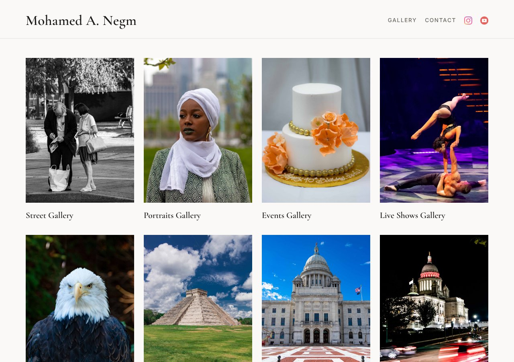

# Mohamed A. Negm Photography

My photography portfolio site. It has 17 galleries, from street and portraits to long exposure and macro, with a lightbox for viewing each photo full size.

**Live site:** https://moenegm.github.io/Photography/



## What's inside

- A home page with one card per gallery, and a contact page with an about section
- Gallery pages with square thumbnails that open in a [Lightbox2](https://lokeshdhakar.com/projects/lightbox2/) viewer with arrows
- A responsive layout that works on phones and wide screens
- Photos sized for the web: thumbnails are 600 px and full-size images are at most 2400 px, so pages load quickly

## Built with

HTML, CSS (Grid), and Lightbox2 with jQuery. There's no build step.

## Run it locally

Clone the repo and open `index.html` in a browser.

```sh
git clone https://github.com/moenegm/Photography.git
cd Photography
open index.html
```

All photos © Mohamed A. Negm. You can browse the code, but please don't reuse the photos without asking.
